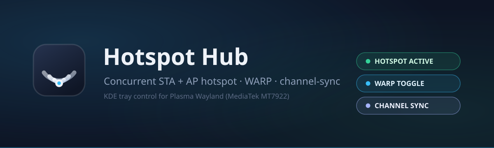
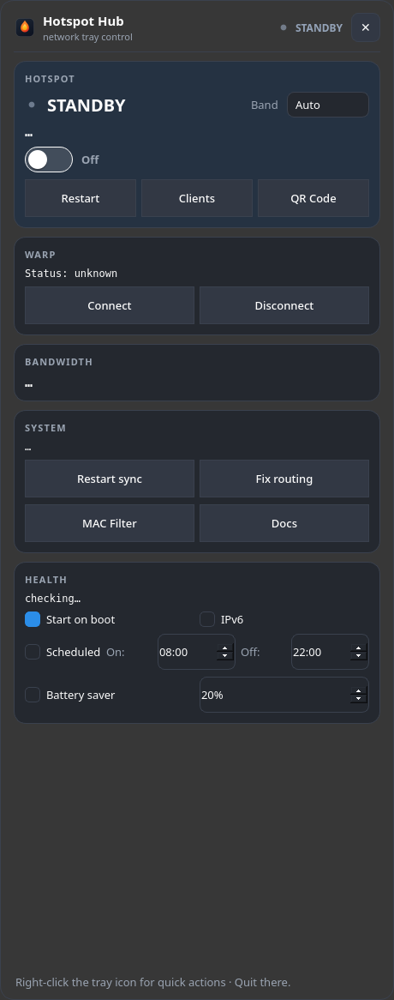

# Hotspot Hub

[](https://github.com/Ekonop/hotspot-hub/releases/latest)
[](LICENSE)
[](https://github.com/Ekonop/hotspot-hub/releases)

KDE system-tray app for concurrent Wi-Fi hotspot (STA/AP, single radio),
WARP toggle, and channel-sync control on Arch/CachyOS (Plasma Wayland,
MediaTek MT7922).





## Features

### Hotspot Control
- **Concurrent STA + AP** on a single radio (virtual `ap0` on `wlan0` PHY).
- **Wi-Fi power-save off** on the STA uplink — avoids MT7922 "limited
  connectivity" dropouts (installed via `src/99-hotspot-powersave.conf`).
- **2.4GHz band policy** — on campus SSIDs (default `KIIT-WIFI-DU`) the
  hotspot is pinned to 2.4GHz, so hotspot clients stay reachable even where
  the campus 5GHz APs are weak.
- **Instrument-deck dropdown**: five stacked cards. Hero card with indicator
  lamp, big state word (ACTIVE / STANDBY / FAULT), band selector, one-line
  readout (SSID · channel · clients · leases · security), an animated
  **master switch**, and a pill-button row (**Restart / Clients / QR Code**).
  Below it: **WARP**, **Bandwidth**, **System**, and **Health** cards. The
  **flame brand mark** is the app icon, the window icon, and the tray icon —
  the tray flame is colored by state (green = on, grey = off, red = error).
- **Channel sync** keeps AP on STA's channel (10s fallback + NM dispatcher events).
- **VPN/WARP bypass** at policy-routing priority 50 (self-repairing).
- **Manual stop respected**: stopping the hotspot no longer auto-restarts via the
  channel-sync daemon (`/run/hotspot-hub-disabled` flag).

### Network & Clients
- **Client list with kick** — show connected stations with **device names**
  (DHCP hostname from the lease — e.g. \"Vansh's iPhone\" — else **mDNS**
  reverse lookup, which resolves devices with private MACs, else the MAC vendor
  from `hwdata`), plus a per-client **Name…** button for a persistent friendly
  name, MAC, IP tooltip, and signal, with disconnect.
- **Configure hotspot name & passphrase** — the hero card's **Configure** pill
  (and `hotspot-hub-cli set-credentials`) renames the SSID and/or changes the
  WPA2 passphrase on the live profile; validation (1–32 SSID, 8–63 psk / 64
  hex) and an automatic restart when the hotspot is active.
- **MAC filtering** — allow/deny lists with enforcement (`iw station del`).
- **Bandwidth monitor** — real-time RX/TX throughput for `wlan0` and `ap0`.
- **Bandwidth throttling** — `tc`-based total cap via `hotspot-hub-cli throttle`.
- **QR code** generation for SSID/PSK (via `qrencode`).

### Configuration
- **Health card** — gateway reachability, AP state, DHCP lease summary with OK/
  ISSUES chip, plus lifecycle controls: Start on boot, IPv6, scheduled on/off
  (08:00/22:00), and battery-saver threshold.
- **Multi-profile** support (list/add/switch/remove via CLI).
- **Scheduled hotspot** — auto on/off at configured times.
- **Battery-aware** auto-disable when battery ≤ threshold.
- **5GHz band selection** (2.4 / 5 / Auto) with channel validation.
- **WPA3-SAE detection** — probes `iw phy` for SAE capability.
- **IPv6 toggle** per profile.
- **Dark / light mode** adaptation via `QPalette` + `KColorScheme`.
- **Global keyboard shortcut** (default `Ctrl+Alt+H`, configurable).

### Integration
- **CLI tool** (`hotspot-hub-cli`) with subcommands: `status`, `on`, `off`,
  `restart`, `clients`, `kick`, `qr`, `band`, `mac-filter`, `throttle`,
  `metrics`, `profile`.
- **D-Bus service** (`org.hotspothub.HotspotHub`) for external control.
- **Prometheus metrics** export (textfile-collector format).
- **Plasma QML applet** scaffold.
- **Autostart** toggle (checkbox + installer flag).
- **Desktop notifications** on client connect/disconnect.

### Quality
- **Unit tests** (33 tests, `unittest`, zero deps).
- **ruff** linting + GitHub Actions CI.
- **Security audit** (`docs/SECURITY-AUDIT.md`): scoped sudoers, no shell
  injection, no secrets logged.
- **Man page** for the CLI.

## Layout

- `app/hotspot-hub.py` — tray app with dropdown canvas (`DropdownPanel`).
  Left-click opens cards (**Hotspot**, **WARP**, **Bandwidth**, **System**,
  **Health**);
  right-click shows the classic menu. UI design decisions and visual roles are
  documented in `docs/UI-REDESIGN.md`. Add future mods as `PanelSection`
  subclasses, registered in `DropdownPanel._build_sections()` (marked EXTENSION POINT).
- `cli/hotspot-hub-cli.py` — CLI tool with all subcommands above.
- `helpers/` — `hotspot-on.sh` / `hotspot-off.sh` (idempotent, `sudo -n`).
- `icons/hotspot-hub.svg` — app icon (flame brand mark on slate tile).
- `assets/` — UI assets: `banner.svg` (README hero), `flame.svg` (brand
  glyph), and `clients-empty.svg` (empty state in the Clients dialog).
- `src/` — system files: channel-sync, NM dispatcher, sysctl, NM power-save
  config, sudoers, systemd user service.
- `scripts/setup-profile.sh` — create/retune `Hotspot-Shared` NM profile.
- `packaging/arch/` — Arch PKGBUILD.
- `flatpak/` — Flatpak manifest.
- `plasma-applet/` — QML plasmoid scaffold.
- `tests/` — unit tests.
- `docs/` — documentation, roadmap, security audit.

No plaintext passwords anywhere.

## Quick install

```bash
./install.sh            # files + sysctl + ufw + service + profile prompt + autostart
hotspot-hub &
```

Options: `./install.sh --no-profile --no-ufw --no-enable --no-autostart`

## Flet UI (modern alternative with system tray)

A beautiful, modern Flet/Flutter-based UI with system tray integration:

```bash
python3 app/hotspot-hub-tray.py
```

This provides:
- **System tray icon** (via pystray) with Open/Quit menu
- **Flet window** that opens on tray click, hides on close (doesn't quit)
- **Modern iOS-inspired UI** with cards, status pills, dark/light mode
- **All backend functionality** shared with the PyQt6 app

Install dependencies:
```bash
pip install --break-system-packages flet flet-desktop pystray pillow
```

Or use the standalone window (no tray):
```bash
python3 app/hotspot-hub-flet.py
```


A beautiful, modern Flet/Flutter-based UI is available as an alternative to the
PyQt6 tray app:

```bash
python3 app/hotspot-hub-flet.py
# or
./hotspot-hub-flet.sh
```

The Flet UI uses the same backend logic (subprocess calls, config, etc.) but
renders with Flutter for a native-feeling, modern interface. It requires
`flet` and `flet-desktop` Python packages.

Install dependencies:
```bash
pip install --break-system-packages flet flet-desktop
```

## Arch package


```bash
make package
sudo pacman -U packaging/arch/hotspot-hub-0.1.0-1-any.pkg.tar.zst
/usr/share/hotspot-hub/setup-profile.sh
```

## Uninstall

```bash
./uninstall.sh          # keeps NM profile + UFW rules
./uninstall.sh --purge  # also deletes profile + UFW rules
```

## CLI usage

```bash
hotspot-hub-cli status
hotspot-hub-cli on | off | restart
hotspot-hub-cli clients
hotspot-hub-cli kick <mac>
hotspot-hub-cli qr
hotspot-hub-cli band [2.4GHz|5GHz|Auto]
hotspot-hub-cli mac-filter <list|allow|deny|block|remove|enable|disable> [mac]
hotspot-hub-cli throttle <iface> <rate_mbps>   # 0 to clear
hotspot-hub-cli set-credentials --ssid NAME [--password PSK]
hotspot-hub-cli metrics [-o FILE]
hotspot-hub-cli profile <list|add|switch|remove> [name]
```

## Configuration

Persistent config: `~/.config/hotspot-hub/config.json`.
Env-style overrides: `~/.config/hotspot-hub/config` (KEY=VALUE lines).
Environment variables: `HOTSPOT_HUB_STA_IF`, `HOTSPOT_HUB_AP_IF`,
`HOTSPOT_HUB_CON`, `HOTSPOT_HUB_DOCS`, `HOTSPOT_HUB_SHORTCUT`.

## Development

```bash
# Lint
ruff check app/ cli/ tests/

# Unit tests
python3 -m unittest discover -s tests -v

# Syntax check
python3 -c "import ast; ast.parse(open('app/hotspot-hub.py').read())"

# Shell validation
bash -n install.sh && bash -n uninstall.sh
```

## Docs

Full setup/ops/troubleshooting: `~/doc/hotspot-system/`
(`README`, `SETUP`, `OPERATIONS`, `TROUBLESHOOTING`, `FILES`).

- [Configuration](docs/CONFIGURATION.md)
- [Architecture](docs/ARCHITECTURE.md)
- [Troubleshooting](docs/TROUBLESHOOTING.md)
- [Roadmap](docs/ROADMAP.md)
- [Security Audit](docs/SECURITY-AUDIT.md)
- [Contributing](CONTRIBUTING.md)
- [Changelog](CHANGELOG.md)
