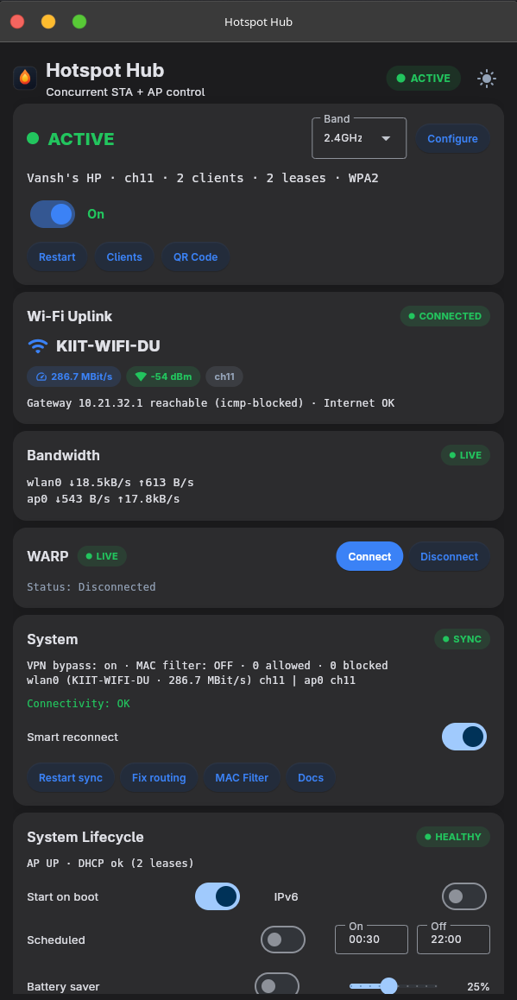
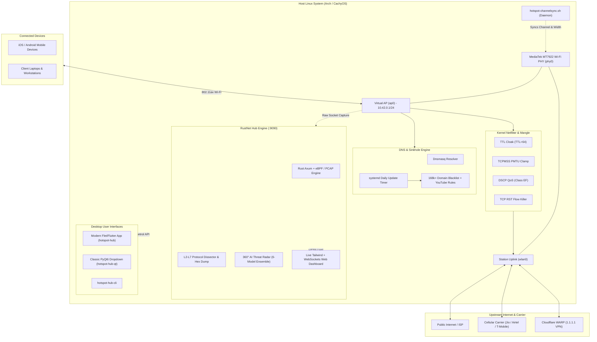

<div align="center">

# 🔥 Hotspot Hub

### High-Performance Concurrent Wi-Fi Hotspot, Deep Packet Inspection (DPI) & Threat Intelligence Engine

[](https://github.com/Ekonop/hotspot-hub/releases/latest)
[](https://cachyos.org)
[](https://flet.dev)
[](https://www.rust-lang.org)
[](LICENSE)

<br/>

**Hotspot Hub** transforms single-radio Linux machines (MediaTek MT7922 / mt7921e on Arch & CachyOS Wayland) into enterprise-grade, concurrent STA+AP Wi-Fi routers equipped with real-time Deep Packet Inspection, an AI-powered Threat Radar, in-flight packet modification, and automated network-wide ad & malware sinkholing.

<br/>


</div>

---

## ⚡ Highlights

| Feature | Description |
| :--- | :--- |
| **Concurrent STA + AP** | Shares a single physical Wi-Fi radio (`wlan0`) with an isolated virtual access point (`ap0`) on subnet `10.42.0.0/24`. |
| **Channel Synchronization** | Background daemon automatically locks `ap0` to `wlan0`'s active operating frequency & channel with 0-packet-drop handoff. |
| **Deep Packet Inspection (DPI)** | Wireshark-grade live dissector across Ethernet L2 $\to$ IP L3 $\to$ TCP/UDP L4 $\to$ TLS/HTTP/DNS L7 with live 16-byte Hex & ASCII dump. |
| **In-Flight Packet Mod** | Kernel netfilter mangling: Carrier TTL Cloaking (`TTL = 64`), TCP MSS Clamping to PMTU, and Low-Latency DSCP Expedited Forwarding. |
| **AI Threat Radar** | 360° threat sweep backed by a **6-Model Ensemble Matrix** (C2 signatures, DGA entropy, exfiltration, telemetry, adult/NSFW). |
| **Zero-Config Adblock Sinkhole** | 168,000+ local DNS sinkhole rules with YouTube ad mitigation, bandwidth saved metrics, and daily auto-updates via systemd timer. |
| **Cloudflare WARP Bypass** | Instant priority-50 policy routing bypass toggle to seamlessly route hotspot traffic with or without VPN encapsulation. |
| **Adaptive Desktop Frontends** | Modern Obsidian-styled Flutter/Flet tray app with persistent window memory + fallback classic PyQt6 dropdown canvas. |

---

## 📸 Interface Preview

<div align="center">
  
  <p><em>Modern Obsidian Flet UI — Real-time telemetry, 3-tab segmented navigation, and client station controls</em></p>
</div>

<details>
<summary><b>View Classic PyQt6 Canvas (Legacy Frontend)</b></summary>
<div align="center">
  <br/>
  
  <p><em>PyQt6 Dropdown Deck with stacked status cards (available via <code>hotspot-hub --legacy-qt</code>)</em></p>
</div>
</details>

---

## 🛠️ Architecture & Core Components



---

## 🚀 Quick Start & Installation

### Option 1: Native Arch Linux Package (Recommended)

```bash
# Clone the repository
git clone https://github.com/Ekonop/hotspot-hub.git
cd hotspot-hub

# Build and install the Arch package
make package
sudo pacman -U packaging/arch/hotspot-hub-*.pkg.tar.zst

# Run initial profile setup & launch
hotspot-hub &
```

### Option 2: Direct System Installer

```bash
git clone https://github.com/Ekonop/hotspot-hub.git
cd hotspot-hub

# Run the idempotent installer (installs services, sudoers, NM rules, and desktop icons)
./install.sh

# Launch the desktop UI
hotspot-hub &
```

*Installer options:* `./install.sh [--no-profile] [--no-ufw] [--no-enable] [--no-autostart]`

---

## 🖥️ Launching the Application

Hotspot Hub provides multiple specialized interfaces for desktop and terminal workflows:

```bash
# 1. Primary Modern Interface (Flutter/Flet + System Tray)
hotspot-hub

# 2. Classic Qt Dropdown Canvas (Fallback)
hotspot-hub --legacy-qt
# or:
hotspot-hub-qt

# 3. Web Traffic Inspector & DPI Dashboard
# Open in your browser (local or connected client device):
xdg-open http://127.0.0.1:9090   # (or http://10.42.0.1:9090 on client)
```

---

## 🌐 RustNet Traffic Inspector & DPI Dashboard

Access the real-time deep packet inspection console at **`http://127.0.0.1:9090`**:

- **Wireshark-Grade Protocol Dissector**: Inspects Layer 2 Ethernet, Layer 3 IPv4/IPv6, Layer 4 TCP/UDP flags and velocities, and Layer 7 Application protocols (TLS SNI, HTTP requests, DNS queries).
- **Interactive Flow Killer**: Instant kernel `tcp-reset` injection (`iptables -I FORWARD 1 -s <ip> -d <ip> -p tcp -j REJECT --reject-with tcp-reset`) to immediately sever persistent TCP sessions.
- **In-Flight Packet Modification (`Tab 5: Packet Mod`)**:
  - **Carrier Tethering Cloak (`TTL = 64`)**: Overwrites egress TTL so cellular carriers (Jio, Airtel, T-Mobile, Verizon) cannot identify or throttle mobile hotspot sharing.
  - **TCP MSS Clamping**: Dynamically clamps MSS to Path MTU, avoiding packet fragmentation over VPN / WARP tunnels.
  - **Low-Latency DSCP Tagging**: Marks real-time VoIP, gaming, and video traffic with Expedited Forwarding (`EF`) DSCP QoS.
  - **HTTP Header Sanitizer**: Strips identifying user-agents and referrers in-flight via transparent proxy filtering.
- **AI Threat Radar**: Real-time 360° polar radar visualizer backed by a **6-Model Ensemble Matrix**:
  1. *C2 & Signature Model*: Identifies botnets, crypto-miners, and malicious TLDs.
  2. *Protocol & Port Anomaly Model*: Detects suspicious ports (SMB 445, Telnet, Tor, Metasploit).
  3. *Privacy & Telemetry Harvester*: Flags aggressive mobile trackers (AppsFlyer, Branch, Adjust).
  4. *Shannon Entropy & DGA Model*: Flags algorithmically generated domains with randomness $> 3.75$ bits/byte.
  5. *Heuristic Exfiltration Model*: Detects high-velocity outbound data leaks ($> 2.5\text{ MB/s}$).
  6. *Adult, Nudity & NSFW Content Filter*: Flags explicit networks, adult web services, and adult trackers.

---

## 🛡️ Zero-Config Ad & Malware Sinkhole

Hotspot Hub includes a local DNS sinkhole engine protecting all connected hotspot clients without requiring any client-side configuration or certificates:

- **168,000+ Active Blocking Rules**: Curated from StevenBlack hosts, AdGuard DNS, and adult/NSFW threat lists.
- **YouTube Ad Mitigation**: Integrated ruleset targeting known mobile and in-app YouTube ad telemetry endpoints.
- **Automated Daily Sync**: Managed via systemd timer (`hotspot-adblock-update.timer`) and service.
- **Custom Domain Sinkholing**: Add arbitrary domains to the network-wide sinkhole on the fly from the UI or web inspector.

---

## ⌨️ CLI Command Reference

The scriptable command-line interface (`hotspot-hub-cli`) gives you complete terminal control:

```bash
# Hotspot lifecycle
hotspot-hub-cli status                       # View live state, active clients, uplink health, and speeds
hotspot-hub-cli on                           # Start the hotspot AP
hotspot-hub-cli off                          # Stop the hotspot AP
hotspot-hub-cli restart                      # Restart AP and force channel re-sync

# Client station management
hotspot-hub-cli clients                      # List connected clients with hostnames, IPs, and signals
hotspot-hub-cli kick <mac>                   # Forcefully disconnect a station (iw station del)

# Wi-Fi credentials & sharing
hotspot-hub-cli qr                           # Render terminal ASCII QR code for instant phone pairing
hotspot-hub-cli set-credentials --ssid NAME [--password PSK]

# Network tuning & policies
hotspot-hub-cli band [2.4GHz|5GHz|Auto]      # Set frequency band
hotspot-hub-cli mac-filter <allow|deny|list> # Manage hardware MAC access lists
hotspot-hub-cli throttle <iface> <rate_mbps> # Set traffic control (tc) rate limit
hotspot-hub-cli metrics [-o FILE]            # Export Prometheus metrics
```

---

## 📂 Repository Structure

```
hotspot-hub/
├── app/
│   ├── hotspot-hub-tray.py        # Modern Flutter/Flet tray app (primary UI)
│   ├── hotspot-hub-flet.py        # Flet desktop launcher entrypoint
│   └── hotspot-hub.py             # Classic PyQt6 dropdown canvas (legacy UI)
├── cli/
│   └── hotspot-hub-cli.py         # Full-featured command-line interface
├── core/
│   ├── hub.py                     # NetworkManager, iw, and system helper library
│   ├── config.py                  # App configuration & profile storage
│   └── oui.py                     # IEEE OUI hardware vendor database
├── services/
│   └── rustnet-hub/               # RustNet DPI backend & Web Dashboard
│       ├── backend/               # Rust Axum server, packet capture, netfilter engine
│       └── frontend/              # Single-page DPI inspector & Threat Radar (Tailwind + Lucide)
├── helpers/
│   ├── hotspot-on.sh              # Idempotent hotspot activation script
│   ├── hotspot-off.sh             # Idempotent hotspot deactivation script
│   └── hotspot-adblock.sh         # Adblock rule generator & updater
├── src/                           # System integration files
│   ├── hotspot-channelsync.sh     # Single-PHY channel synchronization daemon
│   ├── 90-hotspot-channelsync     # NetworkManager dispatcher script
│   ├── 99-hotspot-powersave.conf  # MT7922 uplink power-save disable configuration
│   └── hotspot-adblock-update.*   # Systemd unit & timer files
├── packaging/arch/                # PKGBUILD & packaging metadata for Arch Linux
└── docs/                          # In-depth architectural & operational guides
```

---

## ⚙️ Configuration & Paths

| File / Variable | Purpose |
| :--- | :--- |
| `~/.config/hotspot-hub/config.json` | Persistent user configuration (window dimensions, schedule, battery thresholds). |
| `/etc/NetworkManager/system-connections/Hotspot-Shared.nmconnection` | NetworkManager AP profile credentials and security settings. |
| `/etc/dnsmasq.d/hotspot-adblock.conf` | Generated DNS sinkhole blocking database (168k+ rules). |
| `HOTSPOT_HUB_STA_IF` | Override upstream station interface (defaults to `wlan0`). |
| `HOTSPOT_HUB_AP_IF` | Override hotspot AP interface (defaults to `ap0`). |

---

## 📖 Documentation

- [Architecture & Concurrent Wi-Fi](docs/ARCHITECTURE.md) — Single-radio PHY concurrency and channel tracking mechanics.
- [Configuration Guide](docs/CONFIGURATION.md) — Advanced parameters, powersave rules, and VPN bypass policies.
- [Troubleshooting & Diagnostics](docs/TROUBLESHOOTING.md) — Hardware workarounds, MT7922 tips, and connection debugging.
- [Security Audit](docs/SECURITY-AUDIT.md) — Sudoers least-privilege scoping, sanitization, and safety audits.
- [Roadmap](docs/ROADMAP.md) — Planned features, eBPF extensions, and milestones.

---

## 📄 License

This project is licensed under the [MIT License](LICENSE).
Developed with focus on performance, reliability, and security on Arch & CachyOS.
